# Merecs Language Toolkit – User manual

This manual explains how to create translations with the Language Editor and how to apply
them in your LabVIEW application with the Language Selection library. For installation, see
the [README](../README.md).

## Contents

1. [Overview](#1-overview)
2. [Setup](#2-setup)
3. [Language Editor](#3-language-editor)
4. [Translation formats by element](#4-translation-formats-by-element)
5. [Using the toolkit in your application](#5-using-the-toolkit-in-your-application)
6. [Known issues](#6-known-issues)

## 1. Overview

The toolkit translates the complete user interface of a LabVIEW application. It has two parts:

- **Language Editor**: works like a dictionary. You select the VIs to translate, and enter
  a translation for each control, indicator and string constant in every language. The
  editor saves everything in one JSON translation file.
- **Language Selection** library: loads the translation file when your application starts,
  and applies the translations to all registered front panels. It can switch languages at
  run time.

The toolkit finds controls inside clusters, tab controls and arrays automatically.

### Supported elements

| LabVIEW element              | Translatable parts                                           |
| ---------------------------- | ------------------------------------------------------------ |
| String control               | Caption, string value, tip strip                             |
| Boolean control              | Caption, Boolean text, tip strip                             |
| Ring                         | Caption, ring text, tip strip                                |
| Combo Box                    | Caption, strings (not values), tip strip                     |
| Array (1D, 2D)               | Caption, elements (string arrays only), tip strip            |
| Listbox, Multicolumn Listbox | Caption, item names, headers, tip strip                      |
| Table                        | Caption, items, headers, tip strip                           |
| Tab control                  | Caption, page names, tip strip                               |
| Graph, chart, Digital Graph  | Caption, X/Y scale names, plot names (ASCII only), tip strip |
| Waveform Graph, XY Graph     | Same as graphs, plus cursors                                 |
| String constant              | Value                                                        |
| All other elements           | Caption, tip strip                                           |

## 2. Setup

### Enable Unicode in LabVIEW

Unicode support must be enabled, even if you only plan to use western (ANSI) languages
for now. Add this line to `LabVIEW.ini`, which is located by default in
`C:\Program Files\National Instruments\LabVIEW <version>\` (or `Program Files (x86)` for 32-bit):

```ini
UseUnicode=TRUE
```

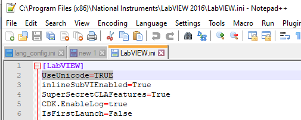

When you build an executable, make sure its `.ini` file contains the same entry.

### Tips for Unicode text

LabVIEW supports Unicode on front panels, but the display is not always reliable. To avoid
problems:

- Paste Unicode text into the Language Editor (for example from a translation tool or a
  text document) instead of typing it.
- For string controls that show Unicode text, right-click the control and select
  **Force Unicode Text**.

### Dynamically loaded VIs

The toolkit only translates VIs in the hierarchy of your main VI. For VIs that your
application loads by path, place a static VI reference on the block diagram of the main VI
(see [Init.vi](#initvi)).

### Cloned and reentrant VIs

The toolkit cannot find clones of reentrant VIs that your application launches dynamically.
Pass their references to the **Clone VIs** input of `Init.vi`, or register them later with
`Add CTRLs By VI Reference.vi`
(see [section 5](#5-using-the-toolkit-in-your-application)).

## 3. Language Editor

If you installed the package with VIPM, start the editor from the LabVIEW menu
**Tools » Merecs Engineering » Merecs Language Toolkit » Language Editor...**. If you work
from the source code, run `src/Language Editor/Language Editor.vi` directly.

The editor has four pages: **Languages** contains the basic settings; **VIs to Translate**,
**Front Panel Translation** and **Text Translation** contain the translations.

> **End-user mode**
> The Language Editor can also be built as an executable, for example to give it to your
> customers. In the executable, end users can only edit existing translations. They cannot
> add or remove elements, and the **VIs to Translate** functions are not available. This
> lets users adjust or extend the translations of a delivered application without changing
> the source code.
>
> The VI package does not include this executable. To create it, clone the repository, open
> `src/Merecs Language Toolkit.lvproj` and build the **Language Editor EXE** build
> specification.

### Paths and files

Set the two paths at the top of the editor first, in this order:

1. **Application Base Folder Path**: the base folder of your LabVIEW project. The editor
   stores the paths of the VIs to translate relative to this folder, so the translation
   file still works when the project is moved or checked out to another location.
2. **Language Config Path**: the JSON translation file to edit. Select an existing file or
   the location for a new one.

The buttons next to the paths work on the translation file:

- **Save** writes your changes to the translation file.
- **Save copy to ...** saves the translations to another file.
- **Export ...** and **Import ...** exchange the translations as CSV, for example with
  external translators.

### Languages

Select the languages you want to translate into. Besides western languages, languages that
need Unicode characters, such as Russian or Chinese, are available.

- To add a language, select it in **List of languages** and click **Add**. The editor
  stores it as an ANSI (western) or Unicode language automatically.
- To remove a language, select it in **Languages to translate** and click **Delete**.

Under **Language Preferences** you set two languages:

- **Startup Language**: the language used when the application starts. When the user
  changes the language at run time, the toolkit saves the new language here, so the
  application always starts in the language selected last.
- **Default Language**: the fallback, used when no translation exists in the selected
  language. This happens, for example, for plot names, which only support ASCII.

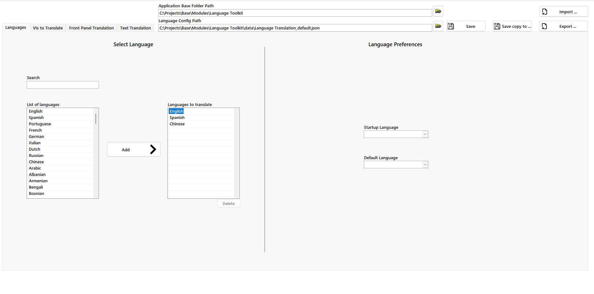

### VIs to Translate

Add the VIs whose front panels you want to translate:

- **+** adds a VI from disk, **–** removes the selected VI, and a third button sorts the
  list alphabetically.
- Double-click a VI to open its front panel, for example to inspect an element.

Next to the list, the editor shows every control and indicator on the selected front
panel, with its class, type and translation status:

| Icon                                                  | Status          | Meaning                                                                     |
| ----------------------------------------------------- | --------------- | --------------------------------------------------------------------------- |
|                                                       | Not Added       | The element is not in the translation file yet.                             |
|  | Some translated | The element is in the translation file, but only some parts are translated. |
|            | Translated      | The element is in the translation file and fully translated.                |
|        | Untranslated    | The element is in the translation file, but not translated.                 |

Use the **Controls Filter** to narrow down the list. All active filters are combined (AND):

| Filter               | Shows only                                          |
| -------------------- | --------------------------------------------------- |
| Filter Label         | Elements whose label contains the entered text      |
| Filter Class         | Elements whose class name contains the entered text |
| No Error Cluster     | Elements that are not error clusters                |
| Only in visible area | Elements in the visible area of the front panel     |
| Only untranslated    | Elements that are not translated yet                |

**Delete Filter** clears all filters.

To add elements to the translation file, select them (use Ctrl or Shift to select
several) and click **Add to Front Panel Translation**. Elements that are already in the
file are skipped. **Go to Translation** opens the selected element on the
**Front Panel Translation** page.

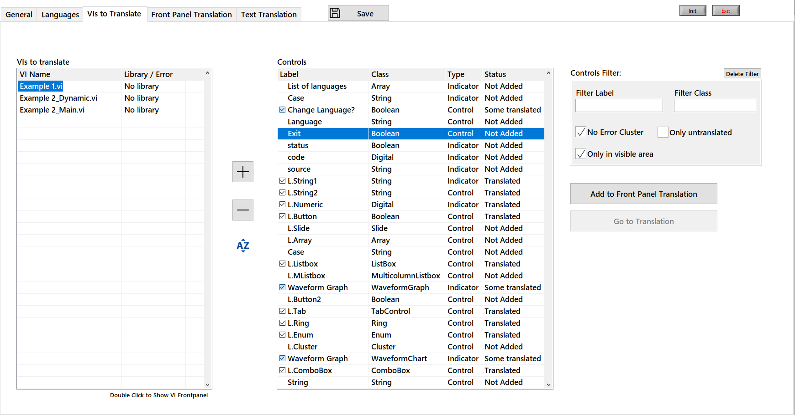

### Front Panel Translation

Here you enter the translations for each element. It works like a dictionary: the
toolkit identifies each element by its **label**, and whenever it finds an element with
that label on a registered front panel, it applies the translation.

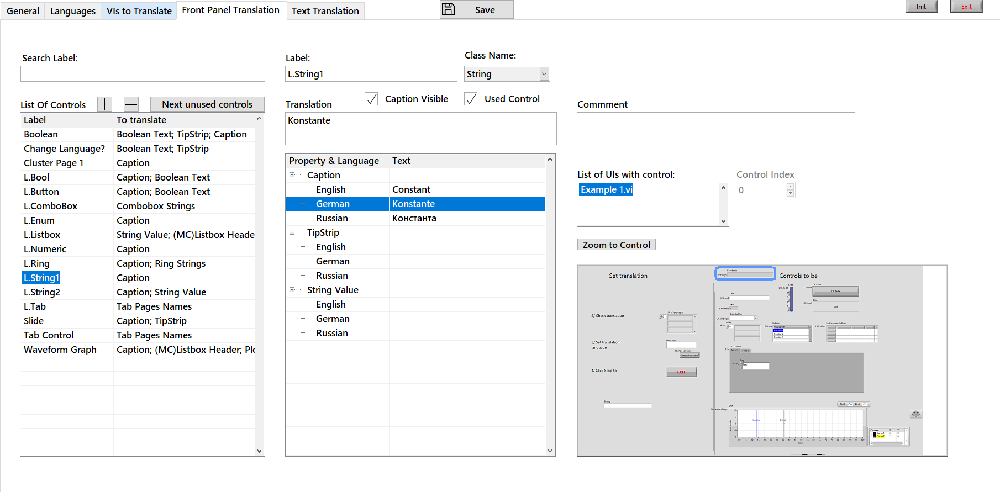

> **Tip:** Use the same labels for recurring elements on different front panels (for
> example *Next*, *Back*, *Refresh*). Then you translate them only once, and they look the
> same everywhere.

Each element offers the translation options that fit its type. The next section describes
the format for each option.

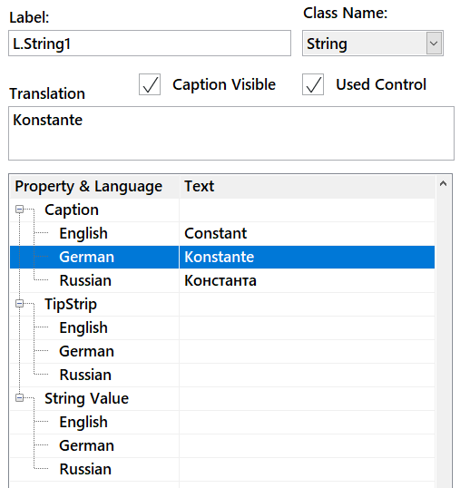

### Text Translation

Here you enter translations for string constants on the block diagram. Your code gets
the translated text with `Translate text.vi`.

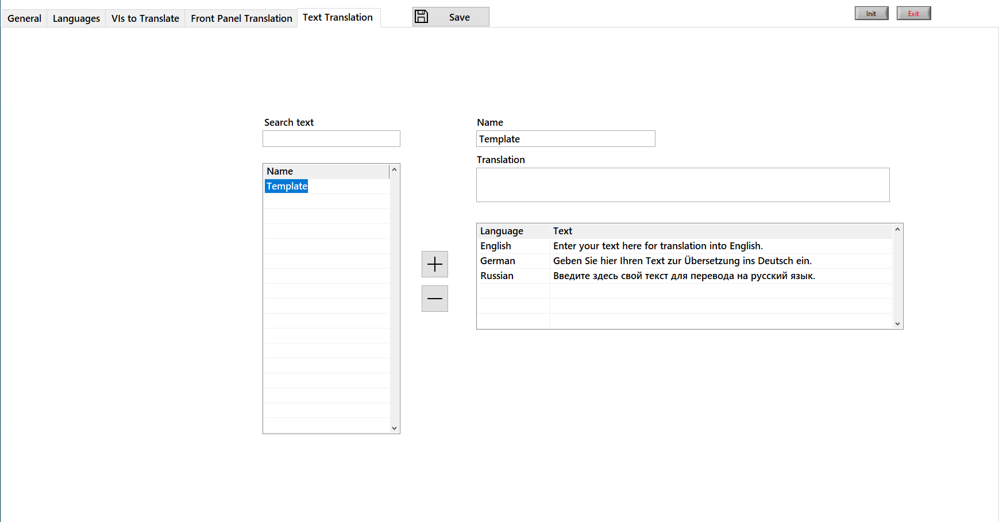

## 4. Translation formats by element

Several options take a list of values. Separate the values with a **semicolon** (`;`).
For two-dimensional data, separate the rows with a **tilde** (`~`).

In each pair of screenshots below, the left image shows the entry in the Language Editor
and the right image shows the result on the front panel.

### Caption

The visible caption of an element. The front panel must show the caption, not the label.
The label is the ID of the translation and is never translated itself.

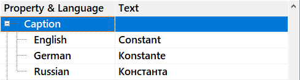

### String value

The text shown in a string element. You do not need to wire a value to the element in
your code, because the toolkit sets the text through a property node.

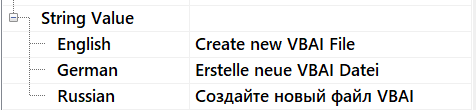

### Boolean text

The text on a Boolean element, such as a button. Enter one, two or four values:

| Values | Applied to                                                                                |
| ------ | ----------------------------------------------------------------------------------------- |
| 1      | All states                                                                                |
| 2      | First value:*True* and *True to False*. Second value: *False* and *False to True* |
| 4      | *True*; *False*; *True to False*; *False to True*                                 |

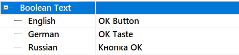 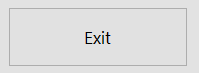

### Ring strings

The items of a ring or drop-down menu, separated by semicolons.

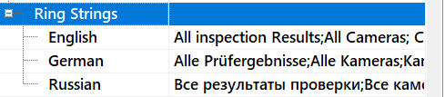 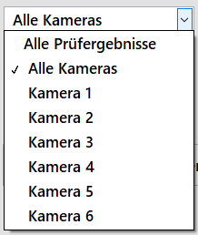

### 1D array elements

The elements of a one-dimensional string array, separated by semicolons.

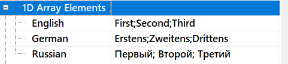

### 2D array elements

The elements of a two-dimensional string array. Separate the elements of a row with
semicolons, and the rows with a tilde. Example for two rows and three columns:
`A1;A2;A3~B1;B2;B3`

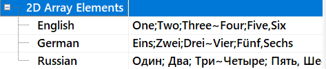 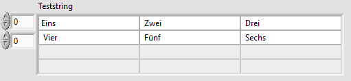

### Listbox and Multicolumn Listbox headers

Separate the column headers with semicolons. To also translate row headers, add them
after a tilde. If you do not use row headers, leave them out.
Example: `Column 1;Column 2~Row 1;Row 2`

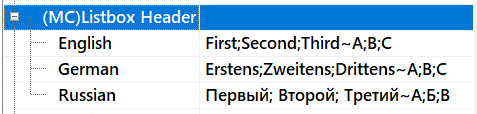 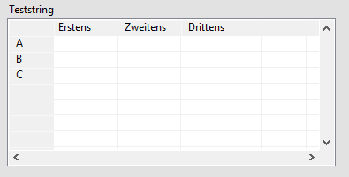

### Listbox and Multicolumn Listbox items

Separate the items of a row with semicolons, and the rows with a tilde, as for
[2D arrays](#2d-array-elements).

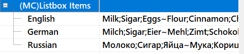 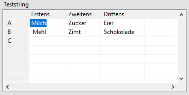

### Tab page names

The names of the pages of a tab control, separated by semicolons.

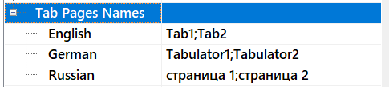

### X and Y scale names (graphs and charts)

The scale names of a graph or chart, separated by semicolons.

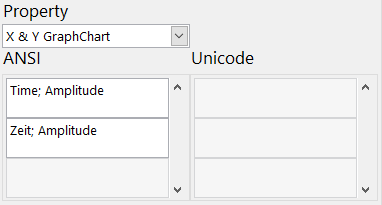 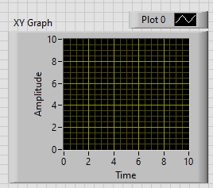

### Plot names

The names of the plots, separated by semicolons. The first value is the name of plot 0,
the second of plot 1, and so on.

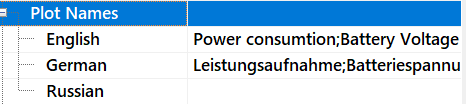 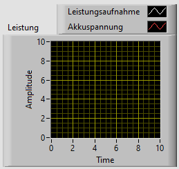

> **Note:** Plot names do not support Unicode. For Unicode languages the editor blocks the
> input and shows a warning. The toolkit then uses the default language.

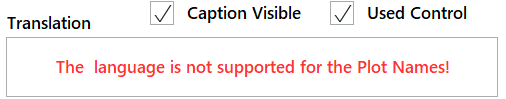

### Table headers

Same format as [Multicolumn Listbox headers](#listbox-and-multicolumn-listbox-headers).

### Table items

Same format as [Multicolumn Listbox items](#listbox-and-multicolumn-listbox-items).

### Tip strip

The tooltip shown when the mouse pointer rests on an element.

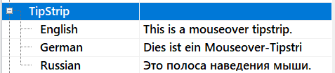 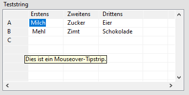

## 5. Using the toolkit in your application

All VIs you need are public VIs in `Language Selection.lvlib`. If you installed the package
with VIPM, you find them on the **Functions** palette under
**Addons » Merecs Language Toolkit**. If you work from the source code, they are in
`src/Language Selection`.

| VI                               | Purpose                                                                |
| -------------------------------- | ---------------------------------------------------------------------- |
| `Init.vi`                      | Loads the translation file and registers the front panels to translate |
| `Add CTRLs By VI Reference.vi` | Registers front panels of dynamically launched VIs                     |
| `Translate front panels.vi`    | Applies a language to all registered front panels                      |
| `Translate text.vi`            | Translates a string constant                                           |
| `Get translation.vi`           | Returns the translation of one property of a front panel element       |
| `Get Language Information.vi`  | Returns the available languages and the language preferences           |

### Init.vi

Call `Init.vi` once at the start of your application, before the front panels you want to
translate are shown. If your application has a launcher that starts all other modules,
you can call it there.

<!-- TODO: Replace vi-init.png with a screenshot that shows the optional Clone VIs input, then re-enable the image. -->

<!-- 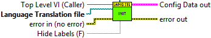 -->

| Terminal                  | Description                                                                                                                                                                      |
| ------------------------- | -------------------------------------------------------------------------------------------------------------------------------------------------------------------------------- |
| Top Level VI (Caller)     | Reference to your main VI. The toolkit searches its complete VI hierarchy for the VIs listed in the translation file (see below).                                                |
| Language Translation file | Required. Path to the translation file                                                                                                                                           |
| Clone VIs                 | Optional. Array of strictly typed references to dynamically launched clones that are already running. Clones launched later are registered with`Add CTRLs By VI Reference.vi`. |
| Config Data out           | The loaded configuration                                                                                                                                                         |

**How the toolkit finds your VIs:** `Init.vi` collects the complete hierarchy of the
top-level VI, including:

- VIs referenced by a **static VI reference**
- all **overrides** of dynamic dispatch VIs (VIs in LabVIEW classes)

Only VIs in this hierarchy are translated. If your application loads VIs dynamically by
path, place a **static VI reference** to each of them on the block diagram of your main VI.
Otherwise the toolkit cannot find them.

`Init.vi` does not look for the translation file itself. Your application decides where
the file is stored and passes the path. If users may change the translations, store the
file in a folder they can write to, not in the program folder.

### Add CTRLs By VI Reference.vi

Registers the front panels of dynamically launched, reentrant VIs (clones) that were not
passed to `Init.vi`. Call it after `Init.vi`, once the clones are running.

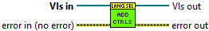

| Terminal | Description                          |
| -------- | ------------------------------------ |
| VIs in   | References to the VIs to register    |
| VIs out  | The same references, for further use |

### Translate front panels.vi

Applies a language to all registered front panels. Run it at least once after `Init.vi`,
and each time the user selects another language, for example on a settings page.

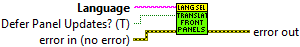

| Terminal                 | Description                                                                                         |
| ------------------------ | --------------------------------------------------------------------------------------------------- |
| Language                 | Name of the language, as returned by`Get Language Information.vi`                                 |
| Defer Panel Updates? (T) | Optional. Defers front panel updates while translating, so the panels do not flicker. Default: True |

If no translation exists in the selected language, the default language is used. The
selected language is saved as the new startup language.

### Translate text.vi

Returns the translation of a string constant defined on the **Text Translation** page.

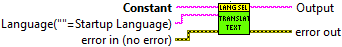

| Terminal       | Description                                                                   |
| -------------- | ----------------------------------------------------------------------------- |
| Constant       | The text to translate, as entered on the**Text Translation** page       |
| Translate? (T) | Optional. If False, the text is passed to the output unchanged. Default: True |
| Language       | Optional. Target language. Empty means the startup language                   |
| Output         | The translated text                                                           |

> **Note:** `Translate text.vi` does not support Unicode.

### Get translation.vi

Returns the translation of one property of a front panel element, as entered on the
**Front Panel Translation** page. Use it when your code needs a translated text that is
not shown directly by the element itself, for example to fill a dialog, a log message or
a dynamically built ring with the translated caption or items of an element.

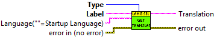

| Terminal    | Description                                                                              |
| ----------- | ---------------------------------------------------------------------------------------- |
| Type        | The translation option to return, for example*Caption*, *Tip Strip* or *Ring Text* |
| Label       | Label of the element, as entered on the**Front Panel Translation** page            |
| Language    | Optional. Target language. Empty means the startup language                              |
| Translation | The translated text                                                                      |

If no translation exists in the selected language, the default language is used. Unlike
`Translate text.vi`, this VI supports Unicode languages.

### Get Language Information.vi

Returns the available languages, the startup language and the default language, for
example to fill a language selection ring.

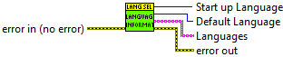

## 6. Known issues

| Issue                                                                                                                                                      | Workaround                                   |
| ---------------------------------------------------------------------------------------------------------------------------------------------------------- | -------------------------------------------- |
| String values of indicators are not translated in some VIs that belong to a LabVIEW class.                                                                 | Use the caption instead of the string value. |
| Unicode text pasted into the Language Editor is sometimes displayed incorrectly the first time. This should be fixed; please report it if it still occurs. | Delete the text and paste it again.          |

Found another problem? Please [open an issue](https://github.com/Merecs/language-toolkit/issues).
